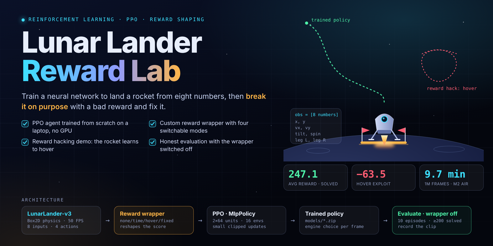
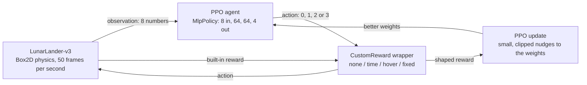
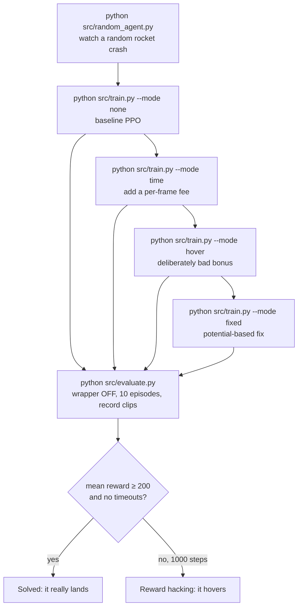

<p align="center">
  
</p>

<h1 align="center">Lunar Lander Reward Lab</h1>

<p align="center">
  <b>Teach a neural network to land a rocket, break it on purpose with a bad reward, then fix it.</b>
</p>

<p align="center">
  
  
  
  
  
  
  
</p>

---

## Contents

1. [Overview](#overview)
2. [Video demos](#video-demos)
3. [How it works](#how-it-works)
4. [Code walkthrough](#code-walkthrough)
5. [Results](#results)
6. [Getting started](#getting-started)
7. [Project structure](#project-structure)
8. [Troubleshooting](#troubleshooting)
9. [What I would do next](#what-i-would-do-next)
10. [Acknowledgements and license](#acknowledgements-and-license)

---

## Overview

### What it is about

Lunar Lander is a small physics game: land a rocket between two flags without crashing. Instead of flying it by hand, this project **trains an AI to fly it** using reinforcement learning (RL). The AI tries thousands of landings, gets points when it does something useful, loses points when it does something bad, and slowly works out how to land.

The interesting part is not the landing. It is that **the AI learns exactly what you score, not what you meant**. This repo builds a small *reward lab* around the game so you can see that happen:

1. Train a baseline agent on the game's built-in reward and watch it land.
2. Add a small per-frame time fee and check it still lands.
3. Add a deliberately bad "+1 per frame while upright and slow" bonus and watch the rocket **learn to hover forever** instead of landing. This is called **reward hacking**.
4. Fix it with **potential-based reward shaping** and watch it land again.

The same idea sits behind real robotics work: if the reward has a loophole, a trained policy will find it.

### Key features

- **PPO agent** (Proximal Policy Optimization) trained from scratch with Stable-Baselines3. About 10 minutes for 1M frames on a MacBook Air M2, CPU only, no GPU.
- **A reward wrapper with four modes** (`none`, `time`, `hover`, `fixed`) so every experiment is the same code with one flag changed.
- **A reproducible reward-hacking demo**, with clips and numbers.
- **Honest evaluation:** every model is tested on the plain game with the wrapper **off**, so a bonus we added cannot flatter the score.
- **Heavily commented code** that explains what the rocket is doing and why (see [Code walkthrough](#code-walkthrough)).

---

## Video demos

> **Replace each placeholder below with a video.** GitHub shows a bare video link on its own line as a native player.
>
> 1. Open this repo on github.com, open `README.md`, click the pencil icon (**Edit this file**).
> 2. Drag your `.mp4` file (under a minute long) from Finder into the editor, onto the placeholder line. GitHub uploads it and pastes a link that looks like `https://github.com/user-attachments/assets/...`.
> 3. Delete the placeholder text so only the link remains on its own line, then **Commit changes**.
>
> Notes: videos on repos owned by a free account are limited to 10 MB, so keep clips short or compress them (H.264 `.mp4` is the safest format). If the editor does not accept the drop, drag the file into the comment box of a new issue instead (do not submit it), copy the link GitHub generates, and paste that link here.
> A backup copy of each clip can live in [`assets/videos/`](assets/videos).

### 1. Random agent: the starting point

🎬 `PLACEHOLDER: drop random_agent.mp4 here` (screen-record `python src/random_agent.py`, or skip this clip)

*No learning. The rocket fires engines at random, tumbles and crashes in about 70 to 95 frames.*

### 2. Trained baseline: it lands

🎬 `PLACEHOLDER: drop baseline_landing.mp4 here`

*PPO after 1M frames. It slows down, levels out and settles between the flags.*

### 3. Reward hacking: it hovers

🎬 `PLACEHOLDER: drop hover_exploit.mp4 here`

*Trained with "+1 per frame while upright and slow". The rocket floats in the air until the 1,000-frame time limit and never lands.*

### 4. The fix: it lands again

🎬 `PLACEHOLDER: drop fixed_landing.mp4 here`

*Trained with potential-based shaping plus a time fee. Hovering no longer pays, so it lands.*

---

## How it works

### The big picture



### The experiment pipeline



### What the rocket sees and does

**Observation.** The game never shows the AI a picture. Every frame (50 per second) it gets eight numbers:

| # | Meaning | Example |
|---|---------|---------|
| 1 | left / right of the pad (x) | `0.20` (a bit to the right) |
| 2 | height above the pad (y) | `0.90` (still high) |
| 3 | sideways speed | `-0.10` (drifting left) |
| 4 | up / down speed | `-0.50` (falling) |
| 5 | tilt | `0.05` (nearly upright) |
| 6 | spin speed | `0.00` (not spinning) |
| 7 | left leg on the ground | `0` (no) |
| 8 | right leg on the ground | `0` (no) |

**Actions.** One choice per frame: `0` do nothing, `1` fire the left side engine, `2` fire the main engine, `3` fire the right side engine.

**One frame of the loop**, which repeats up to 1,000 times per attempt (an *episode*):

1. The game gives the agent the 8 numbers.
2. The neural network turns them into a preference for each of the 4 actions, and an action is chosen.
3. The wrapper passes the action to the game. Physics advances one tick.
4. The game returns the new 8 numbers, a reward, and whether the episode ended.
5. The wrapper may change the reward before PPO sees it.
6. PPO stores the frame. After enough frames it nudges the network toward actions that led to more points.

### The built-in reward

Every frame the game computes a "how good is this position" score: minus 100 times the distance from the pad, minus 100 times the speed, minus 100 times the tilt, plus 10 per leg on the ground. The frame's reward is **how much that score improved since the last frame**, minus 0.3 if the main engine fired or 0.03 if a side engine did (fuel). On the final frame the reward is replaced by **+100 for resting safely** or **-100 for a crash**. Summing every frame gives the score of the episode. An episode is cut off at 1,000 frames.

Because the built-in reward pays for *improvement*, it is hard to exploit. That is the lesson the `fixed` mode borrows.

### Training: play, score, adjust

The network is a function with a few thousand adjustable dials (weights). They start random, so the rocket flails. PPO repeats: fly for a while, see which choices led to more points, and nudge the dials toward them. PPO's one big idea is to keep every update **small** (the *clipping*), so one lucky stretch cannot wreck what has been learned.

### Reward hacking, step by step

| Mode | Extra reward added by the wrapper | What the agent can learn |
|------|-----------------------------------|--------------------------|
| `none` | nothing | land (the built-in reward already points the right way) |
| `time` | -0.05 every frame | land *sooner*; waiting is mildly costly |
| `hover` | **+1** every frame while upright and slow | **hover**: up to +1,000 over a full episode |
| `fixed` | -0.05 every frame, plus `γ·φ(next) − φ(now)` | land, since hovering earns nothing |

Why `hover` wins over landing: an episode ends at 1,000 frames, so hanging in the air can collect up to 1,000 bonus points while paying at most 300 in fuel (1,000 frames × 0.3). Landing **ends** the episode, which stops the +1 payments. So hovering beats landing, and PPO finds that.

Why `fixed` works: instead of paying for *being* in a good state, it pays for the **change** in a potential `φ` (1 when upright and slow, otherwise 0). Staying in the good state pays `γ·1 − 1 = 0.999 − 1 = −0.001` per frame, which is nothing, so there is nothing to farm. This is *potential-based reward shaping*: the potential term adds guidance without changing which policy is best. The time fee does change it, on purpose, by making waiting costly.

---

## Code walkthrough

### `src/reward_wrapper.py`: the heart of the project

- `is_upright_slow(obs)` returns `True` when tilt is under `0.2` and both speeds are under `0.3`. These are in the game's own normalised units.
- `CustomReward` is a Gymnasium **wrapper**: a thin layer around the environment. PPO talks to the wrapper, the wrapper talks to the game, and the wrapper can edit the reward on its way through without touching the game's code.
- `reset()` stores the starting potential so the first frame is not rewarded for being upright when it already was.
- `step()` calls the real game, then edits `reward` depending on `mode`. It also stores the original number in `info["builtin_reward"]`.

### `src/random_agent.py`: the "before" picture

Opens the game window and fires random engines (`env.action_space.sample()`). It prints the 8 observation numbers every 25 frames so you can match them to the table above. In my three runs it crashed in 69 to 94 frames with total rewards from about -306 to -110.

### `src/train.py`: learning

- `make_vec_env(..., n_envs=16)` runs **16 copies of the game side by side** so PPO collects 16 frames per tick. Our wrapper is applied to each copy.
- `PPO("MlpPolicy", ...)` builds the neural network: 8 inputs, two hidden layers of 64 units, 4 outputs.
- Hyperparameters, and what they do:

| Setting | Value | Meaning |
|---------|-------|---------|
| `n_envs` | 16 | game copies running in parallel |
| `n_steps` | 1024 | frames per copy before each update, so 16 × 1024 = 16,384 frames per iteration |
| `batch_size` | 64 | mini-batch size for gradient steps |
| `n_epochs` | 4 | passes over each batch of collected frames |
| `gamma` | 0.999 | how much future reward matters (high, because the +100 for landing comes at the end) |
| `gae_lambda` | 0.98 | bias / variance trade-off when estimating how good an action was |
| `ent_coef` | 0.01 | small bonus for randomness so the policy keeps exploring |
| `device` | `cpu` | the network is tiny, CPU is as fast as the GPU here |

- 1,000,000 frames ÷ 16,384 ≈ 62 iterations, with 4 epochs each, which is why the training log ends at `iterations 62` and `n_updates 244`.
- One note about the log: Stable-Baselines3 places its `Monitor` **under** our wrapper, so `ep_rew_mean` shows the **built-in reward only**, not our shaped reward.

### `src/evaluate.py`: the honest test

- Loads a model and runs it on the **plain** `LunarLander-v3`, with **no wrapper**, so a bonus added during training cannot inflate the number.
- Uses `deterministic=True`: always take the highest-scoring action. Training *samples* actions to explore; testing should not gamble.
- Prints reward, steps and whether each episode was a **timeout** (`truncated=True`). 1,000 steps and a timeout means the rocket hovered instead of landing.
- `--render` shows the window, `--record` saves `.mp4` clips to `videos/` (needs `rgb_array` mode and `moviepy`).
- Always **watch the clip, not just the score**: a score can look fine while the rocket hovers.

### `tools/render_poster.py`

Renders `assets/poster.html` to `assets/poster.png` with a headless browser.

---

## Results

All models were tested on the plain game, wrapper off, deterministic actions, 10 episodes, using `--seed 0` so every model flies the same 10 episodes. "Solved" means a mean reward of 200 or more. Rewards below are the game's own built-in reward, so they are directly comparable.

| Run | Mean reward | Std | Mean steps | Timeouts | Outcome |
|-----|------------:|----:|-----------:|---------:|---------|
| Baseline (`none`) | **237.0** | 26.2 | 427 | 0 / 10 | Solved |
| Time fee (`time`) | **267.3** | 27.6 | 289 | 0 / 10 | Solved, lands noticeably faster |
| Hover bonus (`hover`) | **-52.3** | 27.0 | 1000 | **10 / 10** | **Reward hacking**: hovers, never lands |
| Fixed (`fixed`) | **257.9** | 24.5 | 323 | 0 / 10 | Solved: the fix works |

> Each row is a single training run (one seed), so treat small gaps as noise. Reproduce a row with `python src/evaluate.py --model models/<name> --seed 0`.

### What the numbers say

- **The hover agent never lands.** All 10 episodes hit the 1,000-frame limit, and its mean reward is about 290 points below the baseline.
- **Hovering is a consistent learned behaviour, not luck.** Every episode behaves the same way.
- **The fix works.** With potential-based shaping plus a time fee, the same "upright and slow" idea that caused hovering now lands in 10 of 10 episodes, with no timeouts.
- **The time-fee runs land faster.** In these runs both `time` and `fixed` finish in 289 to 323 steps versus 427 for the baseline. The reward differences between the solved runs (237 to 267) are within about one standard deviation of each other, so this project does not claim one of them scores better, only that they all land.
- **Training logs cannot tell these runs apart; evaluation can.** At the end of training the baseline log showed `ep_rew_mean 141` and `ep_len_mean 974`, and the hover log showed `ep_rew_mean 94.7` and `ep_len_mean 988`. Those look similar, yet evaluation gives 237.0 with 0/10 timeouts for the baseline and -52.3 with 10/10 timeouts for hover. The training log reflects sampled, exploring actions, while evaluation picks the best action each frame.
- **Lesson:** judge a reward by evaluation and by watching clips, never by the training curve alone. And run more than one seed before calling a reward good or bad.

---

## Getting started

### Prerequisites

- Python 3.10 or newer (tested on 3.12)
- Conda (Anaconda or Miniconda) **or** `python -m venv`
- Roughly 1 to 2 GB of free disk (PyTorch is the big one)
- A GPU is **not** needed. Tested on a MacBook Air M2.

### 1. Clone

```bash
git clone https://github.com/damnalee/lunar-lander-reward-shaping.git
cd lunar-lander-reward-shaping
```

### 2. Create the environment

**Option A: conda (recommended)**

```bash
conda env create -f environment.yml
conda activate lunar
```

**Option B: venv + pip**

```bash
python3 -m venv .venv
source .venv/bin/activate
python -m pip install --upgrade pip
python -m pip install -r requirements.txt
```

Using `python -m pip` makes sure packages go into the active environment.

### 3. Check the install

```bash
python -c "import gymnasium, stable_baselines3, torch; print(gymnasium.__version__, stable_baselines3.__version__, torch.__version__); env = gymnasium.make('LunarLander-v3'); print(env.reset()[0])"
```

You should see three version numbers and an array of 8 numbers.

### 4. Run it

All commands run from the repo root.

```bash
# watch a random rocket crash
python src/random_agent.py

# train the baseline (about 10 minutes on an M2 Air)
python src/train.py --mode none --name baseline

# evaluate it with the wrapper off, then watch and record it
python src/evaluate.py --model models/baseline --render
python src/evaluate.py --model models/baseline --record --prefix baseline_landing
```

Reward experiments:

```bash
python src/train.py --mode time  --seed 0
python src/train.py --mode hover --seed 0     # reward hacking: it should hover
python src/train.py --mode fixed --seed 0     # the fix

python src/evaluate.py --model models/ppo_hover_seed0 --record --prefix hover_exploit
python src/evaluate.py --model models/ppo_fixed_seed0 --record --prefix fixed_landing
```

On a Mac, prefix long runs with `caffeinate -i` to stop the laptop sleeping, for example `caffeinate -i python src/train.py --mode hover --seed 0`.

Recorded clips land in `videos/`. Copy the best ones into `assets/videos/` and upload them as described in [Video demos](#video-demos).

### 5. Rebuild the poster (optional)

```bash
python -m pip install playwright
playwright install chromium
python tools/render_poster.py
```

---

## Project structure

```text
lunar-lander-reward-shaping/
├── README.md
├── LICENSE
├── .gitignore
├── requirements.txt
├── environment.yml
├── assets/
│   ├── poster.html          # source of the hero banner
│   ├── poster.png           # rendered banner used at the top of this README
│   └── videos/              # backup copies of the demo clips
├── models/                  # trained PPO models (small .zip files)
├── src/
│   ├── reward_wrapper.py    # the four reward modes
│   ├── random_agent.py      # random baseline
│   ├── train.py             # PPO training
│   └── evaluate.py          # wrapper-off evaluation and clip recording
└── tools/
    └── render_poster.py     # poster.html -> poster.png
```

---

## Troubleshooting

| Problem | Fix |
|---------|-----|
| Box2D install fails and mentions `swig` | Install swig first (`conda install -c conda-forge swig`), then install `gymnasium[box2d]` again. |
| `ModuleNotFoundError: No module named 'gymnasium'` | The terminal is not in the right environment. Run `conda activate lunar` and check the prompt shows `(lunar)`. Use `python -m pip`, not bare `pip`. |
| Old tutorials say `LunarLander-v2` | Current Gymnasium only has `v3`. Change the 2 to a 3. |
| Game window does not open on a Mac | Run the script from the macOS Terminal app instead of the VS Code terminal, or use `--record` instead. |
| Slow or stalling `pip` downloads | `python -m pip install --default-timeout=100 --retries 10 -r requirements.txt`. Already-downloaded files are cached. |
| Score looks great but the rocket never lands | Check the `timeout` column in the evaluation output and watch the clip. That is reward hacking. |

---

## What I would do next

- Run 3 to 5 seeds per mode and report the mean and spread, since one run is not proof.
- Try other shaping signals (for example distance to the pad) and see which ones can be exploited.
- Compare PPO with other algorithms such as DQN or SAC (continuous-action Lunar Lander).
- Log the shaped reward and the built-in reward separately with TensorBoard.

---

## Acknowledgements and license

- [Gymnasium](https://gymnasium.farama.org/) for Lunar Lander and the Box2D physics.
- [Stable-Baselines3](https://stable-baselines3.readthedocs.io/) for the PPO implementation.
- PPO: Schulman et al., *Proximal Policy Optimization Algorithms*, 2017.
- The Hugging Face Deep RL Course, Unit 1, for the training walkthrough.

Released under the [MIT License](LICENSE).
